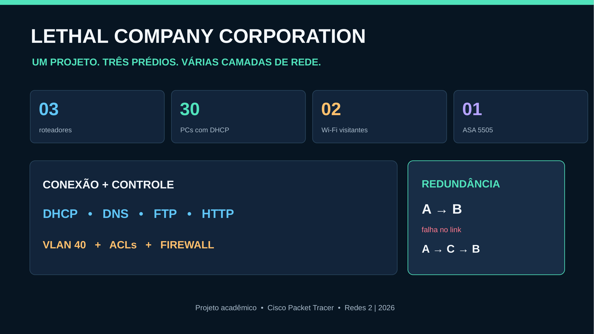
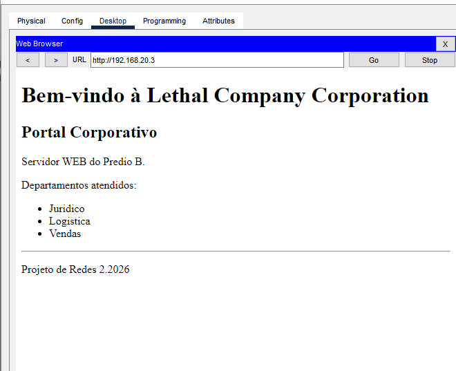

# Lethal Company Corporation — Infraestrutura de Redes

**Projeto acadêmico • Redes de Computadores • 2026 • Cisco Packet Tracer**  
**Resultado da avaliação: nota máxima** 🏆



## Sobre o projeto

Simulação de uma infraestrutura corporativa distribuída em **três prédios**, com endereçamento IPv4, serviços internos, acesso de visitantes, segmentação de rede, controle por firewall e roteamento dinâmico com caminho alternativo. Desenvolvido em equipe como atividade acadêmica, utilizando **Cisco Packet Tracer**.

> **Aviso:** trata-se de um laboratório educacional. Os IPs são privados e as contas presentes no arquivo `.pkt` são de demonstração, **não apropriadas para uso real**.

## Visão geral

| Prédio | Departamentos | Computadores | Serviços / recursos |
|---|---|---:|---|
| **A** | Administrativo, RH, Comercial | 9 | DHCP, DNS, FTP corporativo, Wi-Fi visitantes |
| **B** | Jurídico, Logística, Vendas | 9 | DHCP, portal WEB, Wi-Fi visitantes |
| **C** | Estoque, Compras, Financeiro, TI | 12 | DHCP, VLAN 40, firewall ASA 5505, FTP restrito |

Além dos 30 PCs, o cenário inclui dois notebooks de visitantes, três roteadores Cisco ISR4331, quatro switches Catalyst 3650 e enlaces de fibra e seriais.

## Endereçamento de redes

| Rede | Função |
|---|---|
| `192.168.10.0/24` | Corporativo — Prédio A |
| `192.168.11.0/24` | Visitantes — Prédio A |
| `192.168.20.0/24` | Corporativo — Prédio B |
| `192.168.21.0/24` | Visitantes — Prédio B |
| `192.168.30.0/24` | Corporativo — Prédio C |
| `192.168.40.0/24` | Financeiro — VLAN 40 |
| `192.168.1.0/24` | Servidor exclusivo protegido pelo ASA |

Os enlaces entre os roteadores foram divididos em redes `/30`:

| Enlace | Rede | IPs das extremidades |
|---|---|---|
| A ↔ B | `10.0.0.0/30` | `.1` e `.2` |
| B ↔ C | `10.0.0.4/30` | `.5` e `.6` |
| C ↔ A | `10.0.0.8/30` | `.9` e `.10` |

## Tecnologias e protocolos

- **DHCP e DHCP Relay** — endereçamento automático dos clientes com um servidor DHCP em cada prédio; relay para redes distintas, incluindo a VLAN 40.
- **DNS** — servidor em `192.168.10.10`, resolução de `ftp.corporation.test` para `192.168.10.3`.
- **FTP** — serviço corporativo compartilhado entre funcionários dos três prédios.
- **HTTP** — portal WEB da Lethal Company Corporation, hospedado no Prédio B.
- **VLAN / IEEE 802.1Q** — VLAN 40 dedicada ao Financeiro e enlace trunk para o roteador C.
- **ACL / Cisco ASA 5505** — filtragem de visitantes e restrição ao FTP exclusivo do Financeiro.
- **RIPv2** — roteamento dinâmico entre três roteadores, com `no auto-summary`.

## Segurança: rede do Financeiro

Os computadores do Financeiro ficam na **VLAN 40** (`192.168.40.0/24`), com gateway `192.168.40.1`. O acesso ao servidor exclusivo `192.168.1.2` passa pelo firewall Cisco ASA 5505, que contém uma ACL permitindo tráfego da rede autorizada para o servidor.

Nos testes da simulação, os três PCs do Financeiro conseguiram acessar o serviço; computadores de Estoque, Compras e TI não estabeleceram conexão.

Os roteadores A e B também usam ACLs para impedir o acesso de notebooks visitantes ao FTP corporativo. Esses controles são baseados em redes de origem e não substituem autenticação de usuários em produção.

## Roteamento e redundância: teste prático

A topologia de roteadores foi montada em **triângulo**:

```text
       RTR-A-01 -------- RTR-B-01
           \              /
            \            /
              RTR-C-01
```

O enlace A ↔ B foi temporariamente desativado. Após a convergência do **RIPv2**, a tabela do roteador A mostrou a rota para `192.168.20.0/24` passando por `10.0.0.9` (roteador C), com métrica RIP 2. Mesmo assim, um PC do Prédio B continuou acessando o FTP do Prédio A. Ao restaurar o enlace, voltou a rota direta via `10.0.0.2`, métrica 1.

Esse teste demonstrou **redundância física** (enlaces alternativos) e **adaptação de rotas** pelo RIPv2.

## Evidências da simulação

**Infográfico da infraestrutura**


**Portal WEB acessado de outra filial**



A apresentação com diagramas, conceitos e testes está no arquivo [`apresentacao-tecnica.pdf`](apresentacao-tecnica.pdf).

## Como abrir e testar

1. Instale o Cisco Packet Tracer (projeto salvo originalmente em **8.2.2**).
2. Abra [`Lethal_Company_Corporation.pkt`](Lethal_Company_Corporation.pkt).
3. Verifique as interfaces e o RIPv2 com `show ip interface brief`, `show ip protocols` e `show ip route`.
4. Faça testes de conectividade (`ping`) e acesso HTTP/FTP entre prédios.
5. Para repetir a redundância, desligue **temporariamente** a `Serial0/1/0` do `RTR-A-01` e observe a mudança para o próximo salto `10.0.0.9`. Reative com `no shutdown` e salve.

Veja o roteiro detalhado em [`ROTEIRO_DE_TESTES.md`](ROTEIRO_DE_TESTES.md).

## Principais aprendizados

Planejamento IPv4 e subnetting, instalação de módulos seriais NIM-2T, DHCP/DHCP Relay, configuração de VLAN e trunk, ACLs, firewall ASA, RIP e análise de falhas de comunicação. Durante a implementação, foram resolvidos problemas de pool DHCP, perda de subinterface após reinicialização e alcance do Wi-Fi no modo físico do simulador.

## Observação sobre credenciais

O `.pkt` contém usuários e senhas **fictícios do laboratório**. Não utilize essas credenciais em redes, serviços ou contas reais. Arquivos privados do grupo com listas de senhas não fazem parte deste repositório.

---

**Projeto educacional desenvolvido em equipe.**