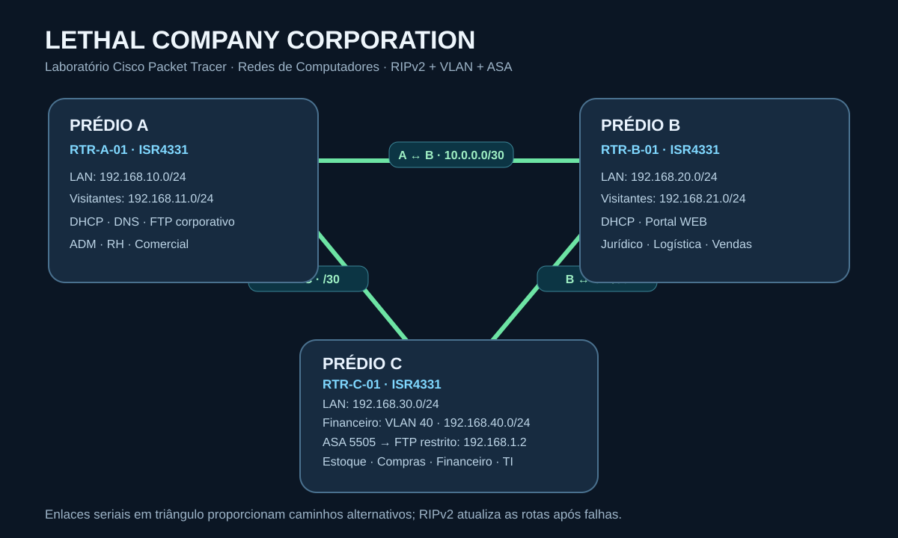

# 🌐 Lethal Company Corporation — Redes Corporativas

**Projeto acadêmico | Redes de Computadores | Cisco Packet Tracer | 2026**  
🏆 **Avaliação: nota máxima**

> Simulação de uma infraestrutura corporativa em três prédios, com serviços de rede, segmentação, firewall e redundância de rotas. Projeto educacional desenvolvido em equipe.



### Explore o projeto

| Recurso | Conteúdo |
|---|---|
| 📦 [Abrir a simulação (.pkt)](packet-tracer/Lethal_Company_Corporation.pkt) | Arquivo original para Cisco Packet Tracer |
| 📖 [Arquitetura e segurança](docs/ARQUITETURA_E_SEGURANCA.md) | Decisões técnicas, fluxos de comunicação, VLAN, ASA e RIP |
| 🧪 [Roteiro de testes](docs/ROTEIRO_DE_TESTES.md) | Comandos para DHCP, DNS, FTP, WEB, ACLs e redundância |
| 📊 [Apresentação em PDF](docs/apresentacao-tecnica.pdf) | Slides e infográficos do trabalho |
| 🖼️ [Infográfico da rede](assets/infografico-rede.png) | Resumo visual da infraestrutura |

## Objetivo

Simular uma empresa com **três prédios interligados**, cada um com departamentos, computadores recebendo IPv4 por DHCP e acesso a serviços corporativos. A solução também inclui:

- Redes Wi-Fi de visitantes nos prédios A e B, com **restrição de acesso ao FTP corporativo**.
- **Servidor exclusivo do Financeiro** protegido por Cisco ASA 5505 e VLAN 40.
- **Roteamento dinâmico RIPv2** entre os prédios, com rotas alternativas quando um enlace falha.
- Conectividade com fibra nas conexões de servidores e rede principal.

## Estrutura da organização

| Prédio | Departamentos | PCs | Serviços |
|---|---|---:|---|
| **A** | Administrativo, RH e Comercial | 9 | DHCP, DNS e FTP corporativo, visitantes Wi-Fi |
| **B** | Jurídico, Logística e Vendas | 9 | DHCP, servidor WEB, visitantes Wi-Fi |
| **C** | Estoque, Compras, Financeiro e TI | 12 | DHCP, VLAN 40, ASA 5505 e FTP restrito |

**Ambiente:** 30 PCs corporativos, dois notebooks de visitantes, três roteadores Cisco ISR4331 e switches Catalyst 3650, entre outros dispositivos.

## Redes e endereçamento

| Sub-rede | Uso |
|---|---|
| `192.168.10.0/24` | Rede corporativa — A |
| `192.168.11.0/24` | Visitantes — A |
| `192.168.20.0/24` | Rede corporativa — B |
| `192.168.21.0/24` | Visitantes — B |
| `192.168.30.0/24` | Rede corporativa — C |
| `192.168.40.0/24` | Financeiro — VLAN 40 |
| `192.168.1.0/24` | Rede protegida do servidor do Financeiro |

Os três enlaces seriais utilizam **redes /30**: `10.0.0.0/30` (A–B), `10.0.0.4/30` (B–C) e `10.0.0.8/30` (C–A).

## Tecnologias aplicadas

**DHCP e DHCP Relay** para atribuição automática de IPv4; **DNS** para resolução de nomes; **FTP** para transferência de arquivos; **HTTP** para o portal; **IEEE 802.1Q** para trunk e VLAN; **ACLs** para controle de acesso; **Cisco ASA 5505** protegendo o serviço Financeiro; e **RIPv2** para propagação dinâmica de rotas.

O servidor DNS (`192.168.10.10`) resolve `ftp.corporation.test` para `192.168.10.3`. O portal WEB do Prédio B responde em `http://192.168.20.3`.

## Segurança: decisões e resultados

**Visitantes:** os roteadores A e B utilizam ACLs para impedir acesso ao FTP corporativo a partir das redes de convidados. Os testes da simulação confirmaram o bloqueio.

**Financeiro:** os PCs estão na **VLAN 40** (`192.168.40.0/24`), separados dos demais departamentos do Prédio C. O firewall **ASA 5505** controla o acesso ao FTP exclusivo (`192.168.1.2`). Nos testes realizados, os PCs do Financeiro conseguiram conectar; os testes com Estoque, Compras e TI não estabeleceram conexão.

Essas políticas são baseadas em endereços de rede no laboratório; não substituem autenticação e outras proteções necessárias em produção.

## Redundância RIPv2 — teste realizado

A topologia **triangular** disponibiliza um enlace direto e um caminho alternativo entre cada par de prédios. Quando desativamos temporariamente o enlace **A–B**, a rota para a rede do Prédio B mudou:

| Estado | Próximo salto no RTR-A-01 | Métrica RIP |
|---|---|---|
| Enlace direto ativo | `10.0.0.2` (B) | 1 salto |
| Enlace A–B desativado | `10.0.0.9` (C) | 2 saltos |
| Enlace recuperado | `10.0.0.2` (B) | 1 salto |

Durante a falha simulada, o computador **JUR1 (Prédio B)** continuou acessando o FTP corporativo no **Prédio A**, por meio do caminho B → C → A. O teste demonstra **redundância física** e **convergência do roteamento**, não uma troca necessariamente instantânea.

## Evidências visuais


**Portal corporativo acessado entre prédios:**


## Como reproduzir os testes

1. Abra o arquivo [`packet-tracer/Lethal_Company_Corporation.pkt`](packet-tracer/Lethal_Company_Corporation.pkt) no Cisco Packet Tracer compatível.
2. Confira a tabela de roteamento com `show ip route` e as interfaces com `show ip interface brief`.
3. Valide DNS, FTP, WEB, DHCP e restrições de acesso com o [roteiro de testes](docs/ROTEIRO_DE_TESTES.md).
4. Para a redundância, desative **temporariamente** a `Serial0/1/0` do RTR-A-01, observe a rota via C e **restaure o enlace com `no shutdown`** após o teste.

## Organização do repositório

```text
.
├── README.md
├── assets/
│   ├── topologia-rede.svg
│   ├── infografico-rede.png
│   └── portal-web.png
├── docs/
│   ├── ARQUITETURA_E_SEGURANCA.md
│   ├── ROTEIRO_DE_TESTES.md
│   └── apresentacao-tecnica.pdf
└── packet-tracer/
    └── Lethal_Company_Corporation.pkt
```

## Observação sobre o laboratório

O `.pkt` contém contas e senhas **fictícias de demonstração**. Não reutilize essas credenciais em sistemas reais. A apostila privada e a lista de senhas do grupo **não estão publicadas** aqui.

---

**Projeto acadêmico realizado em equipe e apresentado com nota máxima.**